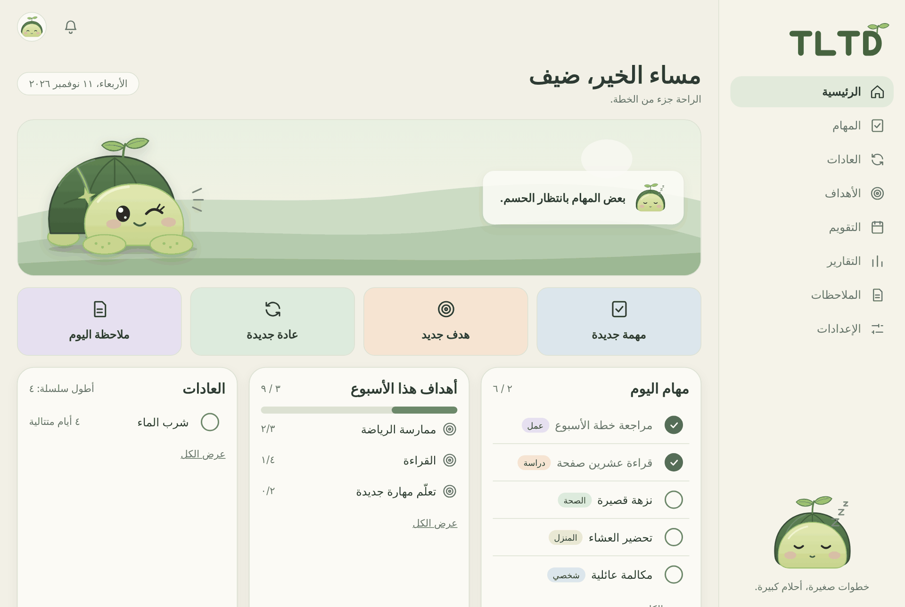

<div align="center">


# TLTD — Too Lazy To Do

**A calm, self-hosted personal assistant for tasks, habits and weekly goals — no pressure, no tracking.**

[العربية](README.md) · [English](README.en.md) · [Deployment](docs/DEPLOYMENT.md) · [Architecture](docs/ARCHITECTURE.md) · [Design](docs/DESIGN.md)

`Python 3.10+` · `Flask` · `SQLite` · `PWA` · `RTL (Arabic UI)` · `MIT`



</div>

---

## What it is

TLTD is a **single-user** web app you run on your own server, so your data stays with you. You write tasks and settle them (done / cancelled) whenever you like — even days later — and the calendar and monthly report give you a gentle visual picture of what got done. No scores, no streak shaming, no comparison. A small turtle mascot reflects the state of your day.

> The user interface is in **Arabic (right-to-left)**. The code, API and docs are open to translation; see [docs/ROADMAP.md](docs/ROADMAP.md).

## Features

- **Tasks:** add, edit, complete, cancel, postpone to tomorrow, delete; six categories.
- **Calendar:** days coloured by outcome (all done / mixed / none done); the week starts on Saturday.
- **Habits:** recurring tasks on chosen weekdays, generated automatically, with a streak counter.
- **Weekly goals:** 1–7 days per week, linked to tasks, with progress and categories.
- **Daily note** and a notes view per month.
- **Monthly report:** totals, donut, weekly bars, day-colour and category charts; **save as an image** on mobile.
- **Notifications (Web Push):** weekly-goal nudge, evening reminder, and a **rest mode** between two dates.
- **PWA:** installable on iOS/Android; bottom navigation and a quick-add dialog on phones; sidebar on desktop.
- **Your data:** CSV export, full wipe with confirmation, password change, recovery code.
- **Themes:** light / dark / auto, and `prefers-reduced-motion` support.

## Tech

Python · Flask · SQLite (stdlib `sqlite3`) · vanilla HTML/CSS/JS (no framework, no build step) · Web App Manifest + Service Worker · optional `pywebpush`, GSAP and Lenis (served locally, never from a CDN).

## Quick start

```bash
git clone <repository-url> tltd && cd tltd
python3 -m venv .venv && . .venv/bin/activate
pip install -r requirements.txt

export SECRET_KEY="$(python3 -c 'import secrets; print(secrets.token_hex(32))')"
export INSECURE_DEV=1            # local development only (allows running without HTTPS)

flask --app app create-user      # prompts for a name, username and password; prints a one-time recovery code
flask --app app run
```

Open <http://127.0.0.1:5000>. **Never set `INSECURE_DEV=1` on a real server.**

## Configuration

| Variable | Required | Description |
|---|---|---|
| `SECRET_KEY` | yes | Long random secret used to sign sessions |
| `DB_PATH` | no | SQLite file path (default `tltd.db`) |
| `TZ_NAME` | no | Time zone used for "today" and the week (default `Asia/Riyadh`) |
| `BEHIND_PROXY` | no | `1` when behind a reverse proxy (Caddy, Nginx) |
| `INSECURE_DEV` | no | `1` for local development without HTTPS only |
| `VAPID_PUBLIC`, `VAPID_PRIVATE_FILE`, `VAPID_SUBJECT` | no | Web Push keys (generate with `flask --app app vapid-gen`) |

## Deployment

You need an always-on server with **HTTPS** (required for installing the PWA and for push notifications). See **[docs/DEPLOYMENT.md](docs/DEPLOYMENT.md)** (Arabic) for a step-by-step VPS guide with Caddy + systemd, a free PythonAnywhere option (no push), notifications, backups and updates.

## Privacy & security

- No third-party requests from the browser: strict CSP (no inline scripts/styles), no CDN fonts or libraries, no analytics.
- Passwords and the recovery code are hashed; session cookie is `HttpOnly`, `Secure`, `SameSite=Strict`; CSRF protection on every write; login rate limiting.
- One account, created from the CLI; there is no public sign-up.
- **Honest note:** data is **not encrypted at rest** in the SQLite file. Protect your server and take backups. See [SECURITY.md](SECURITY.md).

## Tests

```bash
python -m unittest discover -s tests -v          # server: 12 tests
pip install playwright && playwright install chromium
python tests/e2e_smoke.py                         # UI in real Chromium: 51 checks
```

## Verified vs. not verified

- ✔ Server tests (12) and the headless-browser suite (51) pass on Python 3.12 and headless Chromium at three viewport sizes in light and dark mode. (Python versions older than 3.10 were not tried.)
- ✖ Real push delivery, and touch/safe-area/animation/share-sheet behaviour on **physical phones**, were not tested.
- ✖ Deployment steps follow the tools' official docs but were not run on every hosting provider.
- ✖ No Arabic web font is bundled (the system font is used); see [static/fonts/README.md](static/fonts/README.md).

## Contributing & license

Contributions are welcome — see [CONTRIBUTING.md](CONTRIBUTING.md). Report vulnerabilities privately as described in [SECURITY.md](SECURITY.md).

Code and the bundled artwork (mascot and logo) are released under the **MIT License** ([LICENSE](LICENSE)). GSAP and Lenis, if you download them, keep their own licenses and are not redistributed with this project.
