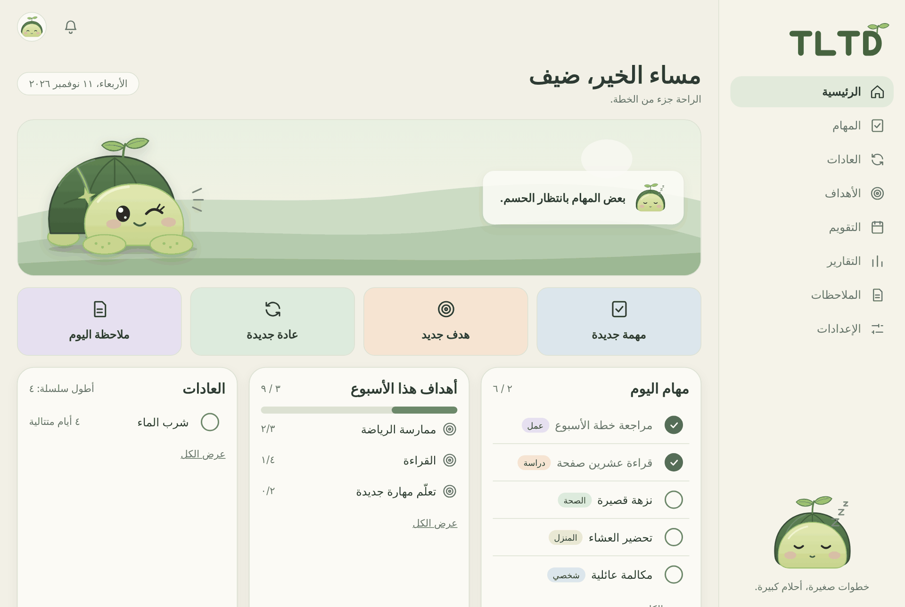
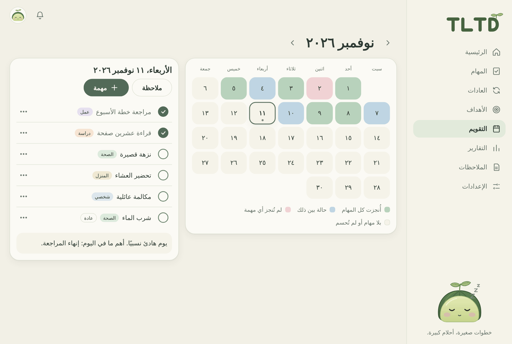
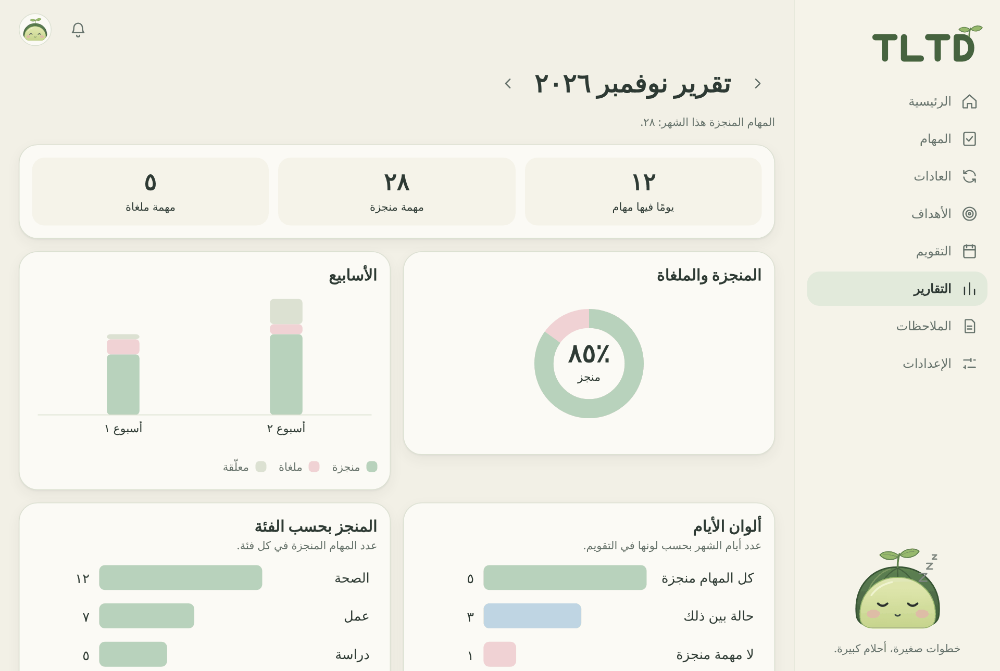
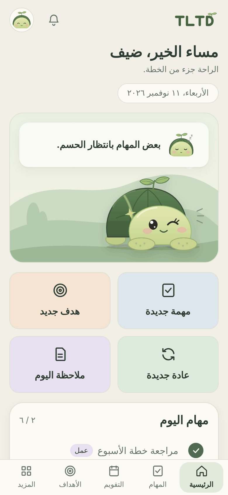
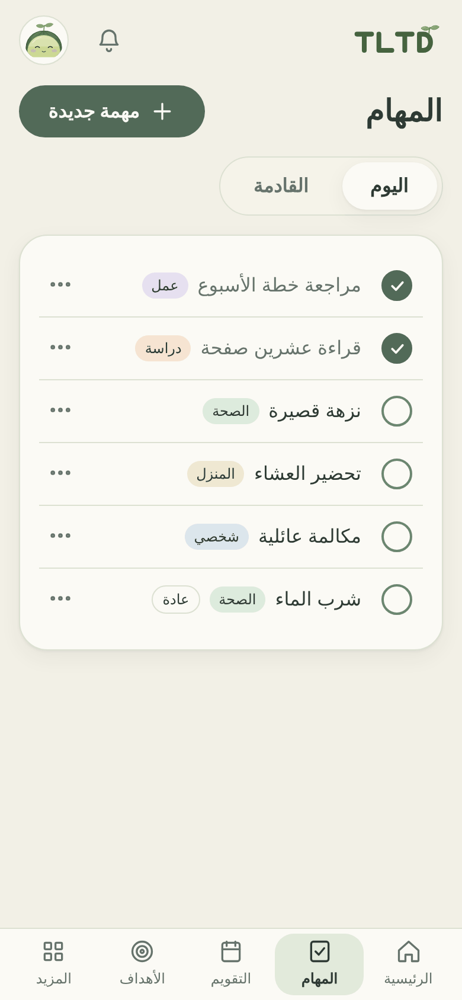
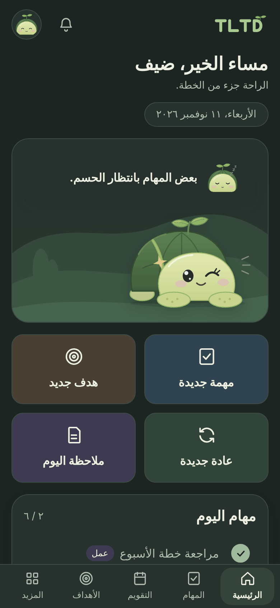
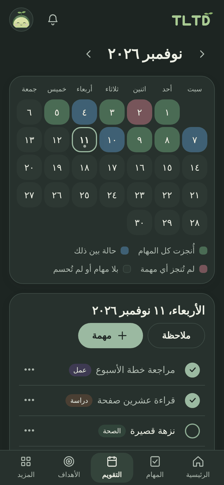
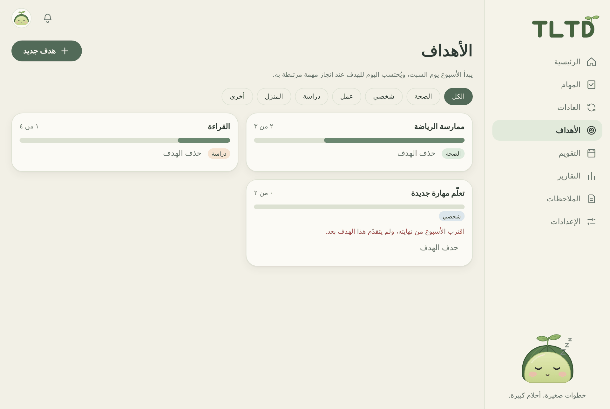
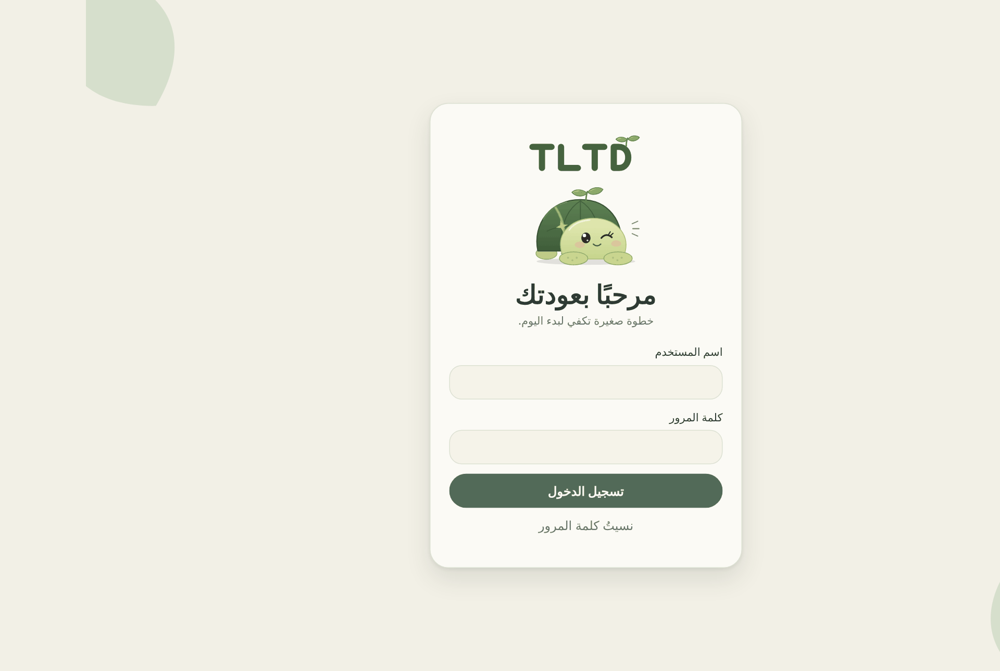

<div align="center">


# TLTD — Too Lazy To Do

**مساعد شخصي هادئ لإدارة المهام والعادات والأهداف، دون ضغط ودون مراقبة.**

[العربية](README.md) · [English](README.en.md) · [النشر](docs/DEPLOYMENT.md) · [البنية](docs/ARCHITECTURE.md) · [التصميم](docs/DESIGN.md)

`Python 3.10+` · `Flask` · `SQLite` · `PWA` · `RTL` · `MIT`



</div>

---

## فكرة المشروع

TLTD (اختصار Too Lazy To Do) تطبيق ويب **لمستخدم واحد**، تُشغّله على خادمك الخاص وتحتفظ ببياناتك عندك. فكرته أن إدارة اليوم يجب ألا تكون عبئًا: تكتب مهامك، وتحسمها (✓ أو إلغاء) متى شئت ولو بعد أيام، فيعرض لك التقويم والتقرير الشهري صورة مرئية هادئة عما أُنجز وما لم يُنجز، دون نقاط أو ترتيب أو مقارنة بأحد.

الشخصية الرئيسية سلحفاة صغيرة تعبّر عن حال اليوم بستة تعابير، ومعها ألوان طبيعية هادئة وواجهة عربية من اليمين إلى اليسار.

## المزايا

| المجال | ما يقدّمه |
|---|---|
| **المهام** | إضافة وتعديل وإنجاز وإلغاء وترحيل إلى اليوم التالي وحذف، مع فئات (الصحة، شخصي، عمل، دراسة، المنزل، أخرى) |
| **التقويم** | شهر ملوّن بحال كل يوم (كل المهام منجزة، حالة بين ذلك، لا مهمة منجزة)، والأسبوع يبدأ يوم السبت |
| **العادات** | مهام تتكرر في أيام تختارها وتُنشأ تلقائيًا، مع عدّاد أيام متتالية |
| **الأهداف الأسبوعية** | هدف بعدد أيام (1–7) تُربط به المهام، وتقدّم أسبوعي، وفئات |
| **ملاحظة اليوم** | ملاحظة نصية لكل يوم، وقسم لاستعراض ملاحظات الشهر |
| **التقرير الشهري** | عدد المنجز، ودائرة المنجز والملغى، وأعمدة الأسابيع، وتوزيع الأيام والفئات، وحفظه **صورةً** من الجوال |
| **الإشعارات** | Web Push: تنبيه الهدف الأسبوعي، وتذكير مسائي، **ووضع راحة** بين تاريخين |
| **الجوال** | يُثبَّت كتطبيق (PWA)، وشريط تنقل سفلي، ونافذة إضافة سريعة |
| **البيانات** | تصدير CSV، وحذف كامل بتأكيد، وتغيير كلمة المرور، واستعادة برمز احتياطي |
| **المظهر** | فاتح وداكن وتلقائي، ودعم «تقليل الحركة» |

<details>
<summary><b>لقطات إضافية</b></summary>

<p align="center">


</p>
<p align="center">




</p>
<p align="center">


</p>

اللقطات مولَّدة ببيانات تجريبية عامة بالأمر `python scripts/screenshots.py`.
</details>

## التقنيات

- **الخادم:** Python وFlask وSQLite (مكتبة `sqlite3` المدمجة، دون ORM).
- **الواجهة:** HTML وCSS وJavaScript عادي، بلا إطار عمل ولا خطوة بناء.
- **PWA:** Web App Manifest وService Worker (يخزّن ملفات الواجهة فقط).
- **الإشعارات:** `pywebpush` (اختياري، يُحمَّل عند الإرسال فقط).
- **اختياري:** GSAP وLenis للحركة (تُخدمان محليًا من `static/vendor/`، وليس من CDN).

## التشغيل السريع

```bash
git clone <رابط-المستودع> tltd && cd tltd
python3 -m venv .venv && . .venv/bin/activate
pip install -r requirements.txt

export SECRET_KEY="$(python3 -c 'import secrets; print(secrets.token_hex(32))')"
export INSECURE_DEV=1            # للتجربة المحلية فقط (يسمح بالعمل دون HTTPS)

flask --app app create-user      # يطلب الاسم واسم المستخدم وكلمة المرور، ثم يعرض رمز الاستعادة مرة واحدة
flask --app app run
```

افتح <http://127.0.0.1:5000>. **لا تستخدم `INSECURE_DEV=1` على خادم حقيقي.**

## الإعدادات (متغيرات البيئة)

| المتغير | مطلوب | الوصف |
|---|---|---|
| `SECRET_KEY` | نعم | مفتاح سري عشوائي طويل لتوقيع الجلسات |
| `DB_PATH` | لا | مسار قاعدة SQLite (الافتراضي `tltd.db`) |
| `TZ_NAME` | لا | المنطقة الزمنية لحساب اليوم والأسبوع (الافتراضي `Asia/Riyadh`) |
| `BEHIND_PROXY` | لا | `1` عند التشغيل خلف وكيل عكسي مثل Caddy أو Nginx |
| `INSECURE_DEV` | لا | `1` للتجربة المحلية دون HTTPS فقط |
| `VAPID_PUBLIC`, `VAPID_PRIVATE_FILE`, `VAPID_SUBJECT` | لا | مفاتيح الإشعارات (تُولَّد بـ `flask --app app vapid-gen`) |

انظر `.env.example`.

## النشر

يلزم خادم يعمل دائمًا مع **HTTPS** (شرط لتثبيت التطبيق وللإشعارات). الدليل الكامل خطوة بخطوة في **[docs/DEPLOYMENT.md](docs/DEPLOYMENT.md)** ويشمل:
- خادم افتراضي (Ubuntu) مع Caddy وsystemd.
- خيار مجاني على PythonAnywhere (بلا إشعارات).
- تفعيل الإشعارات، والنسخ الاحتياطي، والتحديث.

## الخصوصية والأمان

- **لا طلبات إلى أطراف ثالثة من المتصفح:** سياسة CSP صارمة (بلا نصوص أو أنماط مضمّنة)، ولا خطوط أو مكتبات من CDN، ولا تتبّع ولا تحليلات.
- **المصادقة:** كلمات المرور ورمز الاستعادة مجزّأة، وجلسة `HttpOnly` و`Secure` و`SameSite=Strict`، وحماية CSRF لكل طلب كتابة، وحدّ لمحاولات الدخول.
- **الحساب:** حساب واحد يُنشأ من سطر الأوامر، ولا يوجد تسجيل عام.
- **صراحة:** البيانات **غير مشفّرة** داخل ملف SQLite، فمن يصل إلى الخادم يقرؤها. احمِ الخادم وخذ نسخًا احتياطية. التفاصيل في [SECURITY.md](SECURITY.md).

## الاختبارات

```bash
python -m unittest discover -s tests -v            # الخادم: 12 اختبارًا
pip install playwright && playwright install chromium
python tests/e2e_smoke.py                           # الواجهة في متصفح Chromium: 51 فحصًا
```

يغطي اختبار المتصفح الدخول وكل عمليات المهام والأهداف والعادات والملاحظات، وألوان التقويم، والتقرير وحفظه صورةً، والتصدير، والمظهر، وService Worker، وتنقل لوحة المفاتيح، وعدم وجود تمرير أفقي عند 360 و768 و1280 بكسل، وأحجام أهداف اللمس، وغياب أخطاء الكونسول.

## هيكل المشروع

```
app.py                  الخادم وواجهة API وقاعدة البيانات وأوامر CLI
templates/              auth.html (الدخول والاستعادة) · index.html (التطبيق)
static/style.css        نظام التصميم (متغيرات ومكوّنات وتجاوب وحركة)
static/app.js           الواجهة (الحالة، الأقسام، الحوار، التقرير، الإشعارات)
static/img/             الشخصية والشعار (SVG مرسوم يدويًا)
static/sw.js            Service Worker (ذاكرة مؤقتة للواجهة + الإشعارات)
deploy/                 systemd وCaddy وقالب PythonAnywhere
scripts/                vendor.sh (مكتبات الحركة) · screenshots.py
tests/                  test_smoke.py (unittest) · e2e_smoke.py (Playwright)
docs/                   النشر والبنية والتصميم وخارطة الطريق
```

## ما تحقّقنا منه وما لم نتحقق منه

- ✔ اختبارات الخادم (12) واختبار المتصفح الآلي (51) ناجحة، على Python 3.12 وChromium بدون واجهة وبثلاثة أحجام شاشة والوضعين الفاتح والداكن. (الإصدارات الأقدم من Python 3.10 لم تُجرَّب.)
- ✖ لم تُختبر الإشعارات الفعلية، ولا اللمس والمساحة الآمنة والحركات وقائمة المشاركة على **أجهزة جوال حقيقية**.
- ✖ خطوات النشر مبنية على الوثائق الرسمية للأدوات، ولم تُجرَّب على كل مزوّد استضافة.
- ✖ لا يوجد خط عربي مضمَّن (يُستخدم خط النظام)؛ انظر [static/fonts/README.md](static/fonts/README.md).

## المساهمة

المساهمات مرحّب بها: اقرأ [CONTRIBUTING.md](CONTRIBUTING.md). ولأي ثغرة أمنية اتبع [SECURITY.md](SECURITY.md) ولا تنشرها علنًا.

## الترخيص

الكود والرسومات المرفقة (الشخصية والشعار) تحت **رخصة MIT**، انظر [LICENSE](LICENSE). مكتبتا GSAP وLenis (إن حمّلتهما) لهما رخصتاهما الخاصتان ولا تُوزَّعان مع المشروع.
